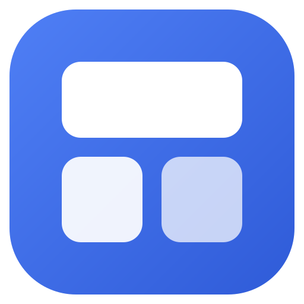

<p align="center">
  
</p>

<h1 align="center">Tabloid</h1>

<p align="center">
  <a href="https://chromewebstore.google.com/detail/tabloid/fjfdlpgpignacaphhlgeabgdbimnobkh"></a>
  <a href="https://addons.mozilla.org/en-US/firefox/addon/tabloid-rss-widget-dashboard"></a>
  <a href="https://microsoftedge.microsoft.com/addons/detail/heacppjhiajeohhbkikmmdbaiojdonla"></a>
</p>

A customizable new tab page and home page, with an RSS reader at its heart. Arrange widgets on a grid, group your feeds, and keep everything on your own device unless you choose to sync it.

Works in Firefox, Chrome, Edge and other Chromium browsers.

## Features

- **RSS feeds.** Group several feeds in one widget. Show them merged (newest first, duplicates collapsed) or one tab per feed, as a compact list, thumbnails or cards. Read items are dimmed. Popular feeds to start from, discovery from a site's address, and OPML import and export.
- **Quick links.** Your favorite sites as icons, page previews or screenshots.
- **Search, Clock, Weather, To-do list and Notes.**
- **Webpages.** Show one or more sites inside a widget, with back and forward. Can optionally show sites that normally refuse to be embedded (only inside Tabloid's own tabs).
- **Dashboards.** Several tabs of widgets, each with its own background if you like.
- **Your look.** Light, dark or follow the system, an accent color, widget opacity and blur, fonts, and backgrounds from your own images, Bing's photo of the day, Wikimedia or Unsplash.
- **Sync, if you want it.** Through your browser account, Dropbox, a WebDAV server or a GitHub repository. Or keep it on this device only (the default).
- **Backups.** Export and import your whole setup as a file.
- **Phones and narrow windows.** The grid becomes a single column, so Tabloid also works in a side-by-side window (and supported mobile browsers).

## Privacy

- No analytics, no tracking, no ads, no remote code.
- Your setup is stored in your browser. It leaves your device only if you turn on a sync provider, and then only goes to the one you pick.
- Sync credentials and uploaded images are never synced or exported.
- Tabloid asks for website access only when a feature needs it (fetching a feed, a page preview or screenshot, showing sites in a Webpages widget), and only fetches what you added.

## Permissions

| Permission | Why |
| --- | --- |
| `storage` | Saves your layout and settings. |
| `alarms` | Refreshes feeds in the background every 30 minutes. |
| `identity` | Signs in to Dropbox, only if you choose Dropbox sync. |
| `declarativeNetRequestWithHostAccess`, `scripting` | Let the Webpages widget show sites that refuse to be embedded, and add back and forward. They do nothing until you turn that option on and grant website access. |
| Website access (optional, asked when needed) | Fetching feeds and page previews, screenshots for Quick links, and the Webpages option above. |

In Firefox, Tabloid also offers itself as the home page. Choose it for new tabs, the home page, or both in Firefox's Settings > Home.

## Development

Requires Node 25 (see `.nvmrc` or use `nvm use 25`).

```bash
npm install
npm run dev            # Chrome, with hot reload
npm run dev:firefox    # Firefox
npm test               # unit tests (Vitest)
npm run compile        # type check
```

The new tab page can also be opened over HTTP at `http://localhost:3000/entrypoints/newtab/index.html` while the dev server runs. It then stores data in `localStorage` instead of extension storage.

### Building and packaging

```bash
npm run build          # .output/chrome-mv3
npm run build:firefox  # .output/firefox-mv3
npm run zip            # store package for Chrome and Edge
npm run zip:firefox    # store package and source archive for Firefox
```

Icons are drawn in `assets/icon/` and rendered to `public/icon/` with `scripts/icons.sh` (needs `rsvg-convert`).

### Project layout

- `entrypoints/`: the new tab page, the settings page, the background worker and the Webpages frame script.
- `components/widgets/<type>/`: one folder per widget, each with a `definition.ts`. New widgets are picked up automatically.
- `utils/`: storage and migrations, sync providers, RSS fetching and parsing, appearance, onboarding.
- `tests/`: Vitest unit and component tests.

Built with [WXT](https://wxt.dev) and Vue 3.

## License

Copyright (c) 2026 Ken Cation. All rights reserved. The source is public so you can see what Tabloid does; it isn't licensed for reuse. See [LICENSE](LICENSE).
